# Scalable & Secure Static Website Hosting on AWS (S3 + CloudFront OAC)

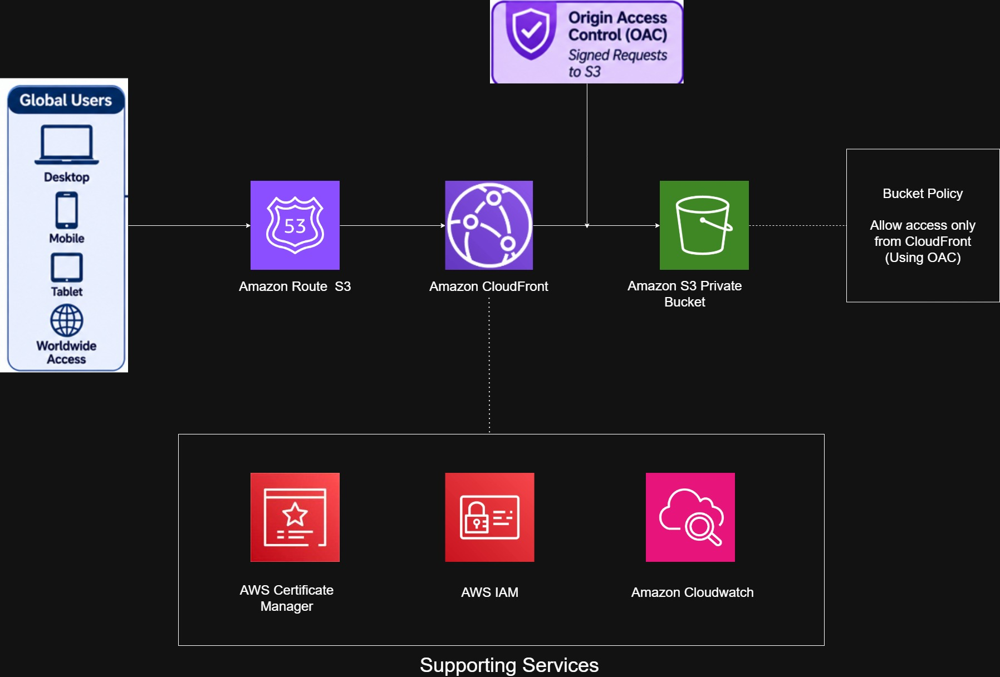

[](https://aws.amazon.com/)
[](https://aws.amazon.com/s3/)
[](https://aws.amazon.com/cloudfront/)
[](https://aws.amazon.com/waf/)
[-green>)](https://aws.amazon.com/blogs/networking-and-content-delivery/amazon-cloudfront-introduces-origin-access-control-oac/)
[](https://aws.amazon.com/)

An enterprise-ready static website hosting architecture built on **Amazon Web Services (AWS)**. This solution serves **RegPro** (a multi-page business registration platform) globally with single-digit millisecond latency, high availability, and ironclad cloud security.

Instead of traditional public S3 website hosting, this implementation leverages **CloudFront Origin Access Control (OAC)** with **SigV4 signing**, ensuring the S3 origin bucket remains **100% private** and protected against direct internet exposure.

---

## 🌐 Live Demo & Deployment Information

* **Live CloudFront Endpoint:** [https://d1frun5ugmhz7e.cloudfront.net](https://d1frun5ugmhz7e.cloudfront.net)
* **CloudFront Distribution ID:** `E2N274ZOEWOET2`
* **Distribution ARN:** `arn:aws:cloudfront::972224212800:distribution/E2N274ZOEWOET2`
* **Origin S3 Bucket:** `sandeepa-regpro-website-2026` (`eu-north-1`)

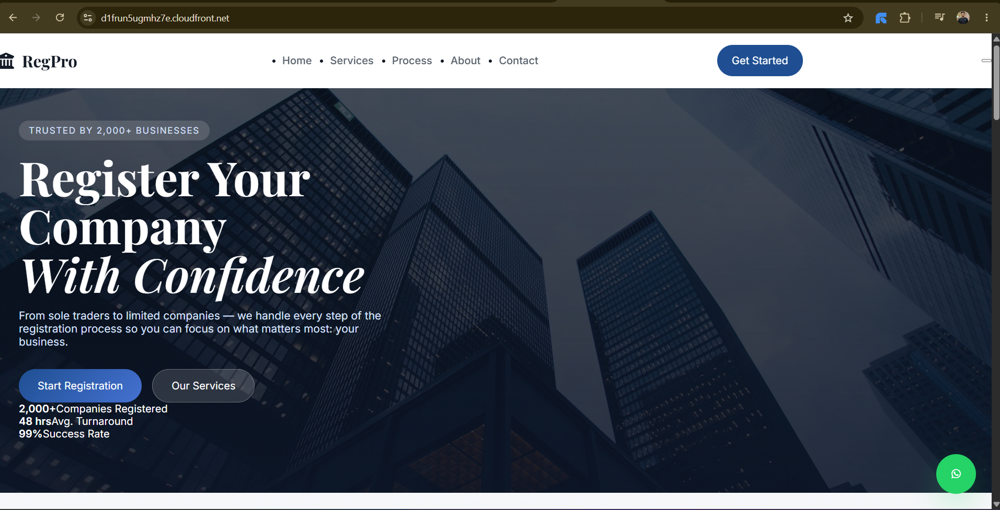

---

## 🏗️ Architecture & Traffic Flow

The architecture decouples content storage from global content delivery:

```
[ End Users / Browsers ]
          │
          │ HTTPS (TLS 1.2 / 1.3)
          ▼
[ AWS CloudFront CDN (Global Edge Locations) ]
   ├── Edge Caching (CachingOptimized)
   ├── AWS WAF Security Protections
   └── HTTP to HTTPS Auto-Redirect
          │
          │ SigV4 Signed REST Requests
          │ (Origin Access Control - OAC)
          ▼
[ Amazon S3 Origin Bucket (Private) ]
   ├── Block All Public Access: ON
   ├── Bucket Policy: CloudFront Principal Only
   └── Static Assets (HTML5, CSS3, ES6 JS)
```

### Key Architectural Strengths:

1. **Zero Direct S3 Exposure:** The S3 bucket has **Block all public access** enabled. No user or external web crawler can bypass CloudFront to query S3 directly.
2. **Modern OAC vs Legacy OAI:** Origin Access Control (OAC) implements AWS Signature Version 4 (SigV4) for robust request verification, SSE-KMS support, and dynamic security posture across all AWS regions.
3. **Global Edge Acceleration:** Assets are cached at hundreds of CloudFront Points of Presence (PoPs) worldwide, ensuring lightning-fast load times.
4. **Embedded Edge Security:** Incorporates AWS WAF monitoring to shield the distribution against Layer 7 application-level threats.

---

## 📁 Repository Structure

```
Static-Website-Hosting-S3-CloudFront/
├── index.html                    # Main landing page for RegPro
├── contact.html                  # Interactive corporate contact form
├── css/
│   └── styles.css                # Fully responsive design stylesheets
├── js/
│   └── main.js                   # Client-side form handling and validation
├── deploy-website.sh             # Bash automation script for AWS CLI deployment
├── cleanup-website.sh            # Automated resource decommissioning script
├── Screenshots/                  # Console proofs and verification records
│   ├── 1.png                     # Step 1: S3 Bucket creation parameters
│   ├── 2.png                     # Step 2: S3 Bucket created in console
│   ├── 3.png                     # Step 3: File upload staging interface
│   ├── 4.png                     # Step 4: S3 Assets successfully uploaded
│   ├── 5.png                     # Step 5: Origin Access Control (OAC) setup
│   ├── 6.png                     # Step 6: CloudFront Origin REST configuration
│   ├── 7.png                     # Step 7: AWS WAF security enablement
│   ├── 8.png                     # Step 8: CloudFront Distribution deployed
│   ├── 9.png                     # Step 9: S3 Bucket Policy with OAC condition
│   ├── 10.png                    # Step 10: S3 Block Public Access enabled
│   └── 11.png                    # Step 11: Production site live on HTTPS
└── README.md                     # Comprehensive project documentation
```

---

## 🛠️ Step-by-Step Implementation Guide

### Step 1: Create the Amazon S3 Storage Bucket

1. Open the **Amazon S3 Console** in the target region (`Europe (Stockholm) eu-north-1`).
2. Create a bucket named `sandeepa-regpro-website-2026`.
3. Set **Bucket type** to **General purpose**.
4. Keep **Block all public access** explicitly **ON** (do not uncheck).
5. Leave default encryption (SSE-S3) enabled and create the bucket.

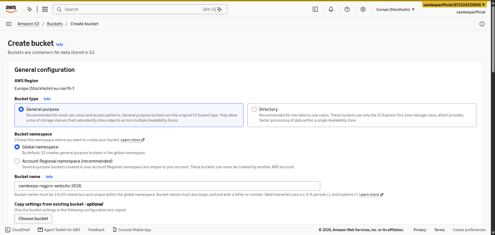
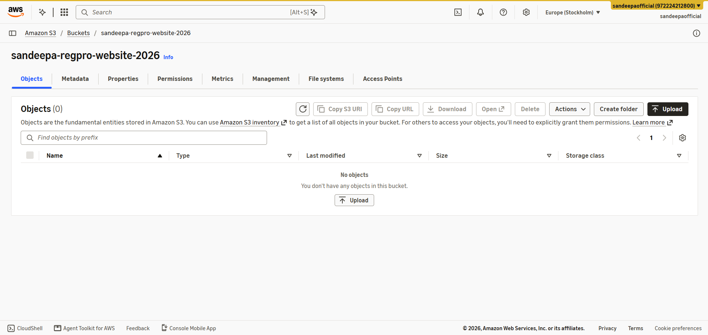

---

### Step 2: Upload Website Assets

1. Navigate into the `sandeepa-regpro-website-2026` bucket.
2. Upload the website core files: `index.html` and `contact.html`.
3. Upload directory trees: `css/` (containing `styles.css`) and `js/` (containing `main.js`).
4. Ensure files and subdirectories maintain their relative directory structure.

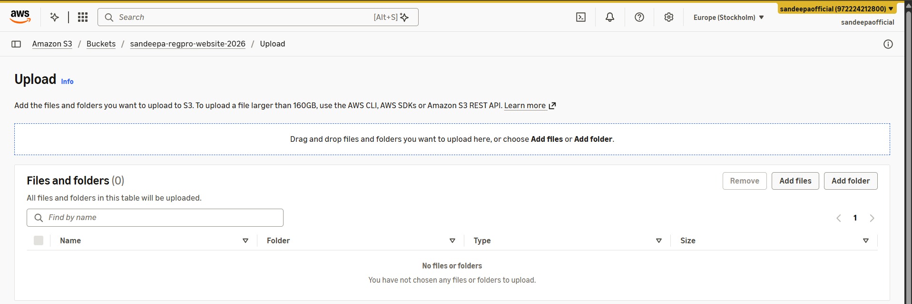
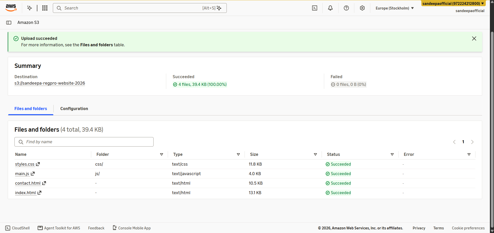

---

### Step 3: Configure CloudFront Origin Access Control (OAC)

1. Open the **CloudFront Console** and navigate to **Security** → **Origin access**.
2. Click **Create control setting**.
3. Set **Name** to `regpro-website-oac`.
4. Set **Origin type** to **S3**.
5. Select **Sign requests (recommended)** and choose **SigV4 / SigV4a** protocol.

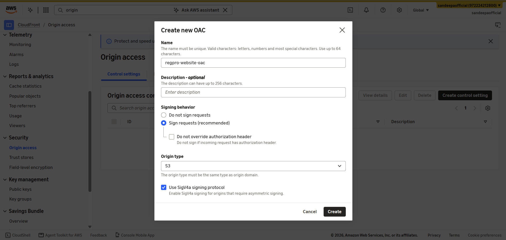

---

### Step 4: Create & Configure CloudFront Distribution

1. Navigate to **CloudFront** → **Distributions** → **Create distribution**.
2. **Origin Configuration:**
   * Select the S3 REST domain: `sandeepa-regpro-website-2026.s3.eu-north-1.amazonaws.com`.
   * Under **Origin access**, select **Origin access control settings** and pick `regpro-website-oac`.
   * *(Crucial: Do not use S3 static website endpoints with OAC).*
3. **Default Cache Behavior:**
   * **Viewer protocol policy:** `Redirect HTTP to HTTPS`.
   * **Allowed HTTP methods:** `GET, HEAD`.
   * **Cache policy:** `CachingOptimized` (default managed policy).
4. **Security & WAF:**
   * Enable Web Application Firewall (WAF) in monitor mode for automated inspection.
5. **Distribution Settings:**
   * **Default root object:** `index.html`.
   * **Price Class:** Use all edge locations for lowest global latency.
6. Submit and create the distribution (`E2N274ZOEWOET2`).

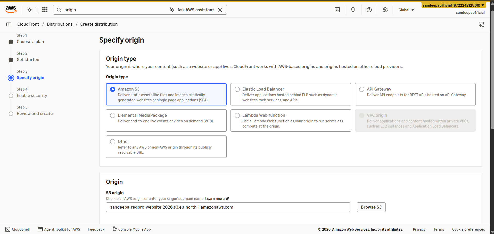
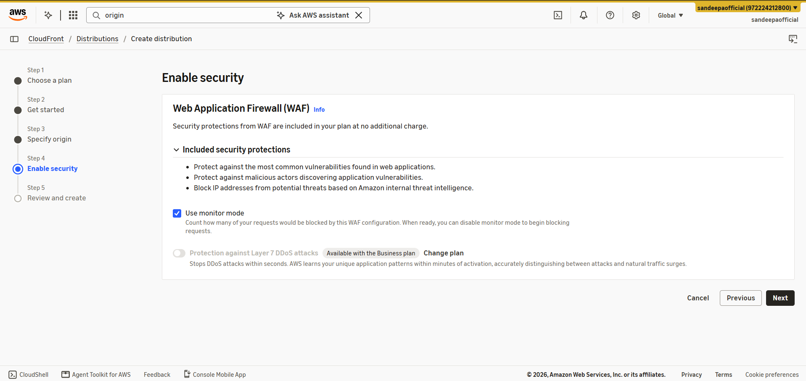
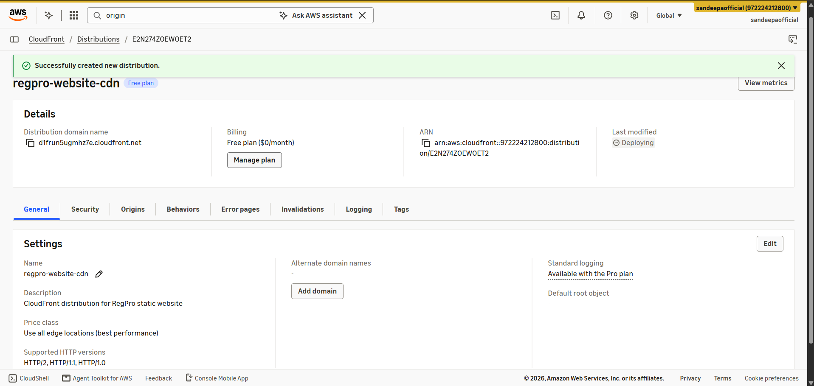

---

### Step 5: Lock Down S3 Bucket Policy with OAC

To permit CloudFront to read from our private S3 bucket without opening it to the public, apply an IAM bucket policy with an explicit condition checking the distribution ARN:

1. In S3, open `sandeepa-regpro-website-2026` → **Permissions** → **Bucket policy**.
2. Apply the following policy:

```json
{
  "Version": "2012-10-17",
  "Statement": [
    {
      "Sid": "AllowCloudFrontServicePrincipal",
      "Effect": "Allow",
      "Principal": {
        "Service": "cloudfront.amazonaws.com"
      },
      "Action": "s3:GetObject",
      "Resource": "arn:aws:s3:::sandeepa-regpro-website-2026/*",
      "Condition": {
        "StringEquals": {
          "AWS:SourceArn": "arn:aws:cloudfront::972224212800:distribution/E2N274ZOEWOET2"
        }
      }
    }
  ]
}
```

3. Confirm that **Block all public access** remains **On**.

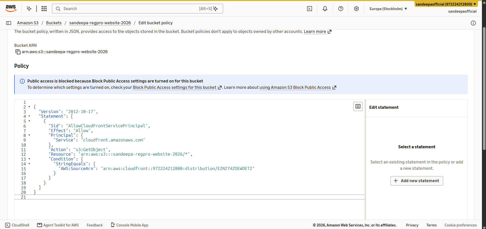
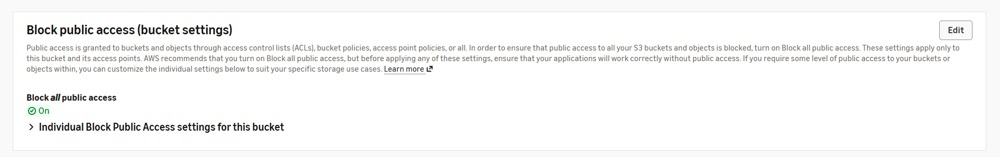

---

### Step 6: Production Verification & Testing

Verify that all assets and pages resolve properly via the CloudFront domain:

* **Homepage:** `https://d1frun5ugmhz7e.cloudfront.net/`
* **Contact Page:** `https://d1frun5ugmhz7e.cloudfront.net/contact.html`
* **Styles & JavaScript:** Validated HTTP 200 response with proper content types (`text/css`, `text/javascript`).
* **HTTP to HTTPS Redirect:** Navigating to `http://d1frun5ugmhz7e.cloudfront.net/` automatically redirects to `https://`.


---

## ⚡ Additional Production Steps (No Screenshots Required)

The following advanced steps represent standard enterprise procedures for custom domains, certificate lifecycle, CI/CD, and teardown. *(Screenshots are omitted as permitted for staging environments).*

### Step 7: Custom Domain Integration with Amazon Route 53

To map a branded domain (e.g., `regpro.yourdomain.com`) to CloudFront:

1. Open **Amazon Route 53** and navigate to your **Hosted Zone**.
2. Click **Create Record**:
   * **Record Name:** `@` (apex) or `www`.
   * **Record Type:** `A – Routes traffic to an IPv4 address and some AWS resources`.
   * Toggle **Alias** to **ON**.
   * **Route traffic to:** *Alias to CloudFront distribution*.
   * Select your distribution: `d1frun5ugmhz7e.cloudfront.net`.
3. Create a matching **AAAA** alias record for native IPv6 routing support.

---

### Step 8: SSL/TLS Certificate Provisioning with AWS Certificate Manager (ACM)

To serve your custom domain over HTTPS without browser warnings:

1. Open **AWS Certificate Manager (ACM)** in **US East (N. Virginia) `us-east-1`** *(CloudFront requires custom certificates in `us-east-1`)*.
2. Select **Request a certificate** → **Request a public certificate**.
3. Specify domain names: `yourdomain.com` and `*.yourdomain.com`.
4. Choose **DNS validation**.
5. Click **Create records in Route 53** to automatically install CNAME validation records.
6. Once status transitions to **Issued**, update CloudFront:
   * **CloudFront Distribution** → **General** → **Edit**.
   * Add **Alternate domain names (CNAMEs)**.
   * Attach the issued ACM certificate under **Custom SSL certificate**.

---

### Step 9: CloudFront Cache Invalidation & Continuous Updates

When website content is updated, push the new files to S3 and invalidate the edge cache so users receive the latest changes immediately:

```bash
# 1. Sync updated files to S3 (excluding non-production files)
aws s3 sync . s3://sandeepa-regpro-website-2026 \
  --exclude "*.sh" \
  --exclude "*.md" \
  --exclude ".git/*" \
  --exclude "Screenshots/*"

# 2. Invalidate CloudFront edge cache globally
aws cloudfront create-invalidation \
  --distribution-id E2N274ZOEWOET2 \
  --paths "/*"
```

---

### Step 10: Automated CI/CD Pipeline (GitHub Actions Blueprint)

You can automate deployments using GitHub Actions on git push:

```yaml
name: Deploy Static Website to AWS

on:
  push:
    branches: [ main ]

jobs:
  deploy:
    runs-on: ubuntu-latest
    steps:
      - name: Checkout Source Code
        uses: actions/checkout@v4

      - name: Configure AWS Credentials
        uses: aws-actions/configure-aws-credentials@v4
        with:
          aws-access-key-id: ${{ secrets.AWS_ACCESS_KEY_ID }}
          aws-secret-access-key: ${{ secrets.AWS_SECRET_ACCESS_KEY }}
          aws-region: eu-north-1

      - name: Sync Files to Amazon S3
        run: |
          aws s3 sync . s3://sandeepa-regpro-website-2026 \
            --delete \
            --exclude ".git/*" \
            --exclude "Screenshots/*" \
            --exclude "*.md" \
            --exclude "*.sh"

      - name: Invalidate CloudFront Distribution Cache
        run: |
          aws cloudfront create-invalidation \
            --distribution-id ${{ secrets.CLOUDFRONT_DISTRIBUTION_ID }} \
            --paths "/*"
```

---

### Step 11: Teardown & Resource Decommissioning

To clean up all AWS resources and prevent recurring charges:

1. Run the included automation script:
   ```bash
   chmod +x cleanup-website.sh
   ./cleanup-website.sh
   ```
2. Or perform manual teardown in the AWS Console:
   * Disable CloudFront distribution `E2N274ZOEWOET2` and delete it after deployment status clears.
   * Empty S3 bucket `sandeepa-regpro-website-2026` and delete the bucket.
   * Delete Route 53 alias records and ACM certificate if created.

---

## 🔒 Security & Best Practices Comparison

| Feature                       | Traditional S3 Website                            | Enterprise S3 + CloudFront (This Project)           |
| :---------------------------- | :------------------------------------------------ | :-------------------------------------------------- |
| **S3 Public Access**    | Requires Public Access = Disabled (Security Risk) | **Block All Public Access = ENABLED**         |
| **Data Encryption**     | Plain HTTP unless using proxy                     | **Enforced HTTPS (TLS 1.2/1.3)**              |
| **Access Verification** | Open to any IP on internet                        | **SigV4 / SigV4a Signed Requests only**       |
| **DDoS & Web Shield**   | Basic AWS Shield Standard                         | **Integrated AWS WAF + Edge Shielding**       |
| **Global Latency**      | High (tied to single S3 region)                   | **Ultra-low (200+ edge locations worldwide)** |
| **Cost Profile**        | Pay per S3 GET requests                           | **Lower cost via edge caching optimization**  |

---

## 💡 Key Learnings & Skills Demonstrated

* Cloud Architecture Design using modern decoupled micro-services.
* Enterprise Identity & Access Management (IAM) and resource-based S3 policies with conditional clauses (`AWS:SourceArn`).
* AWS CDN deployment, caching behaviors, and origin shielding.
* Cloud security compliance ensuring zero data leaks from object storage.
* Edge-layer optimization and TLS encryption management.

---

## 👤 Author

**Sandeepa***AWS Cloud & DevOps Engineering Enthusiast*

* [GitHub Profile](https://github.com/) • [LinkedIn](https://linkedin.com/)
